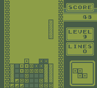
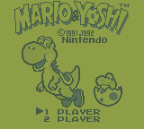

<div align="center">
	<br>
	
	<h1>🎮 GAME BOY ONLINE 🕹️</h1>
	<p>
		<b>A high-performance, full-featured Game Boy emulator built with modern web & native technologies.</b>
		<br />
		<i>Play classic retro titles seamlessly inside your browser or on desktop with deep hardware inspection tools.</i>
	</p>
	<br>
	<p>
		<a href="#showcase"><b>Demo & Screenshots</b></a> •
		<a href="#features"><b>Features</b></a> •
		<a href="#architecture"><b>Architecture</b></a> •
		<a href="#getting-started"><b>Quick Start</b></a> •
		<a href="#docs"><b>Component Documentation</b></a> •
		<a href="#controls"><b>Controls</b></a> •
		<a href="#license"><b>License</b></a>
	</p>
	<br>
	<i>Technologies / Libraries / Frameworks / License:</i>
	<p>
		<p>
			
			<a href="https://webassembly.org/">
				
			</a>
			
		</p>
		<p>
			<a href="https://react.dev/">
				
			</a>
			<a href="https://vite.dev/">
				
			</a>
			<a href="https://tailwindcss.com/">
				
			</a>
			
		</p>
		<p>
			<a href="https://www.mysql.com/">
				
			</a>
			
			<a href="https://github.com/naudio/NAudio">
                
            </a>
			<a href="https://gplv3.fsf.org/">
				
			</a>
		</p>
	</p>
	<br>
</div>

---

<br>
<h2 align="center" id="showcase">📸 Showcase</h2>
<div align="center">
	
	
	<p><sub><i>🕹️ Classic titles running smooth at full 60 FPS in browser via WebAssembly.</i></sub></p>
</div>
<br>

---

<br>
<h2 align="center" id="features">✨ Key Features</h2>
<table>
<tr>
	<td width="50%" valign="top">
	<h3>⚡ High Performance</h3>
	<ul>
		<li><b>C# Core Engine</b> - Optimized hardware instruction processing & clock cycles.</li>
		<li><b>WebAssembly Speed</b> - Near-native execution performance straight in the browser.</li>
		<li><b>Fluid Audio Output</b> - Low-latency APU emulation with stereo channel support.</li>
	</ul>
	</td>
	<td width="50%" valign="top">
	<h3>🛠️ Developer & Debugging</h3>
	<ul>
		<li><b>Real-time Inspector</b> - View CPU Registers, Memory Maps, VRAM & Timers.</li>
		<li><b>Breakpoints & Step</b> - Pause execution and inspect state step-by-step.</li>
		<li><b>Interrupt Diagnostics</b> - Monitor IE/IF flags and timer counters live.</li>
	</ul>
	</td>
</tr>
<tr>
	<td width="50%" valign="top">
	<h3>🎮 Gameplay & Controls</h3>
	<ul>
		<li><b>Custom Keybindings</b> - Easily map controls to your keyboard.</li>
		<li><b>Save States & Battery RAM</b> - Save your progress anytime.</li>
		<li><b>Cross-Platform Support</b> - Run on Web or as a native Windows App.</li>
	</ul>
	</td>
	<td width="50%" valign="top">
	<h3>📂 Library & Management</h3>
	<ul>
		<li><b>ROM Drag & Drop</b> - Instant game load from disk.</li>
		<li><b>BIOS Support</b> - Boot ROM execution for full nostalgia.</li>
		<li><b>Backend Storage API</b> - Organize, manage, and sync your game files.</li>
		<li><b>Database support</b> - abitity to switch between disk and database.</li>
	</ul>
	</td>
</tr>
</table>
<br>

---

<br>
<h2 align="center" id="architecture">🛠️ Tech Stack & Architecture</h2>
<table>
	<tr><th width="25%">Component</th><th width="25%">Stack / Technology</th><th width="50%">Description</th></tr>
	<tr><td>🧠 <code>GB/</code></td><td>C# / .NET 10</td><td>Pure core emulator logic: CPU, BUS, MEM, PPU, APU & Timers</td></tr>
	<tr><td>⚙️ <code>GB.WASM/</code></td><td>C# / WebAssembly</td><td>WebAssembly hooks exported for JavaScript.</td></tr>
	<tr><td>🌐 <code>GB.Frontend/</code></td><td>React, JS, Vite</td><td>Responsive Web GUI, canvas graphics renderer & browser client</td></tr>
	<tr><td>⚡ <code>GB.Backend/</code></td><td>ASP.NET Core API</td><td>RESTful backend for ROM hosting and management</td></tr>
	<tr><td>🖥️ <code>GB.WinForms</code>/</td><td>Windows Forms</td><td>Native desktop application wrapper for Windows</td></tr>
</table>
<br>

---

<br>
<h2 align="center" id="getting-started">🚀 Getting Started</h2>

> [!NOTE]
> Make sure you have **[.NET 10.0](https://dotnet.microsoft.com/)** and **[Node.js (v25.9.0+) / npm (11.17.0+)](https://nodejs.org/)** installed on your machine.
<br>

<h3 align="center">1. Clone Repository 📥</h3>

```bash
git clone https://github.com/Mikolaj0524/GameBoyOnline.git
cd GameBoyOnline
```
<br>

<h3 align="center">2. Build WASM for frontend ⛏️</h3>

```bash
cd GB.WASM
dotnet publish -c Release
```
<br>

<h3 align="center">3. Launch Frontend 💻</h3>

```bash
cd GB.Frontend
npm install
```

```bash
npm run dev
```
<p align="center">or (if you want to host on web server)</p>

```bash
npm run build
```
<br>

<h3 align="center">4. Launch Backend API ⚙️</h3>

```bash
cd GB.Backend
dotnet build
dotnet run
```

> 🎉 Open your browser at `http://localhost:5173` and start playing!

<h3 align="center">X. If you want to launch WinForms 🪟</h3>

```bash
cd GB.WinForms
dotnet build
dotnet run
```
<br>

---
<br>
<h2 align="center" id="docs">📚 Component Documentation</h2>
<p align="center">
    Dive deeper into specific parts of the GameBoyOnline ecosystem:
</p>
<div align="center">
    <p>
        🧠 <a href="./GB/README.md"><b>Emulator Core (GB)</b></a> •
        ⚙️ <a href="./GB.WASM/README.md"><b>WebAssembly (WASM)</b></a> •
        🌐 <a href="./GB.Frontend/README.md"><b>Frontend (React)</b></a>
    </p>
    <p>
        ⚡ <a href="./GB.Backend/README.md"><b>Backend API</b></a> •
        🖥️ <a href="./GB.WinForms/README.md"><b>Desktop Client (WinForms)</b></a>
    </p>
</p>
<p align="center">
    Project also contains documentation inside code.
</p>
<br>

---
<br>
<h2 align="center" id="controls">⌨️ Controls & Keybindings</h2>


> [!NOTE]
> These are the default keybindings and can be fully customized in the settings.


<table>
	<tr align="center">
		<td><code>⬆️ Up</code></td>
		<td><code>⬇️ Down</code></td>
		<td><code>⬅️ Left</code></td>
		<td><code>➡️ Right</code></td>
		<td><code>🔴 Button A</code></td>
		<td><code>🟡 Button B</code></td>
		<td><code>⏹️ Start</code></td>
		<td><code>⏺️ Select</code></td>
	</tr>
	<tr align="center">
		<td>Up Arrow</td>
		<td>Down Arrow</td>
		<td>Left Arrow </td>
		<td>Right Arrow </td>
		<td>,</td>
		<td>.</td>
		<td>Enter</td>
		<td>Shift</td>
	</tr>
</table>
<br>

---
<br>
<h2 align="center" id="license">📜 License</h2>
<p align="center">
	Distributed under the <b>GNU General Public License v3.0</b>. See <a href="LICENSE">LICENSE</a> for more details.
</p>
<br>

---

<code>These README files were initially drafted with AI assistance, then thoroughly reviewed, edited, and aligned with the current state of the application.</code>